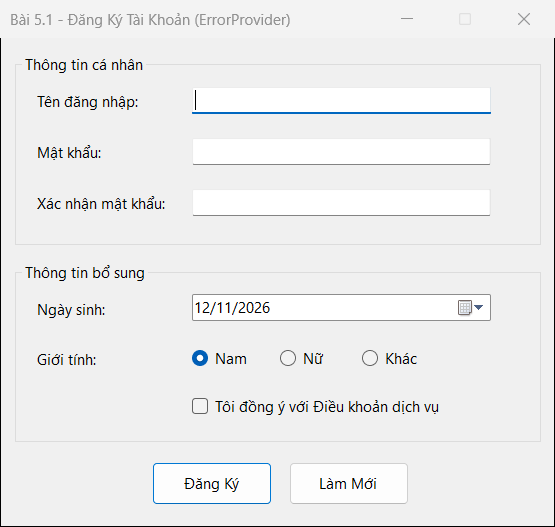
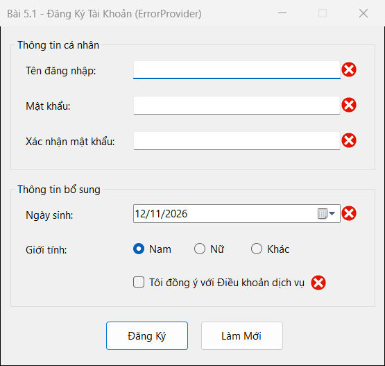
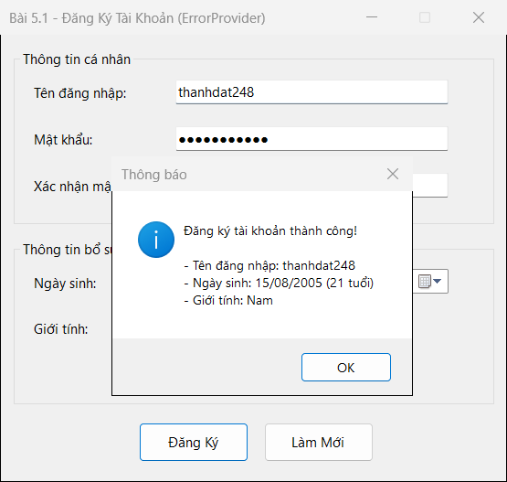

## THÔNG TIN SINH VIÊN
- **Họ và tên:** Phan Công Thành Đạt
- **Mã số sinh viên:** 24810310223
- **Lớp:** D19CNPM3
- **Tên môn học:** Lập trình .NET / Windows Forms
- **Tên bài tập:** Bài 5.1: Form đăng ký tài khoản và bắt lỗi giao diện (ErrorProvider)

---

## DANH SÁCH ẢNH CHỤP MINH HỌA KẾT QUẢ

### 1. Giao diện khởi động ban đầu

---

### 2. Bắt lỗi kiểm tra dữ liệu đầu vào bằng ErrorProvider (`epCheck`)

---

### 3. Nhập dữ liệu hợp lệ (`UseSystemPasswordChar = true`, >= 18 tuổi) & thông báo thành công

