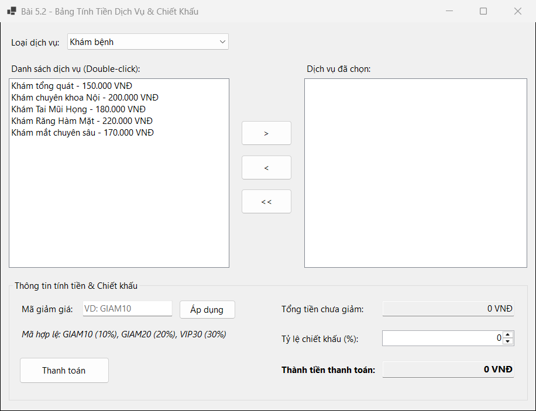
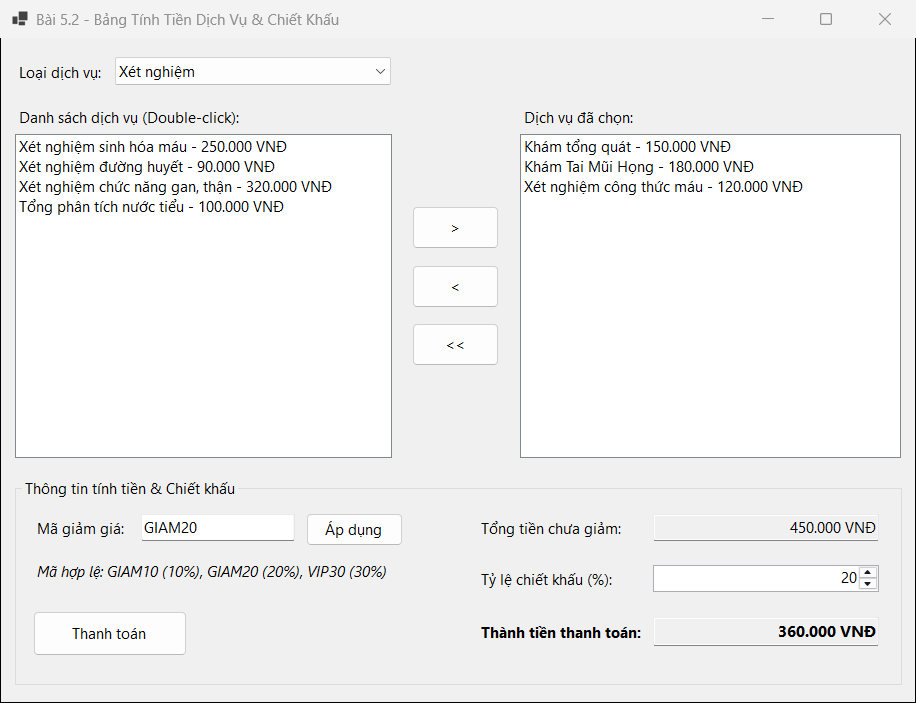
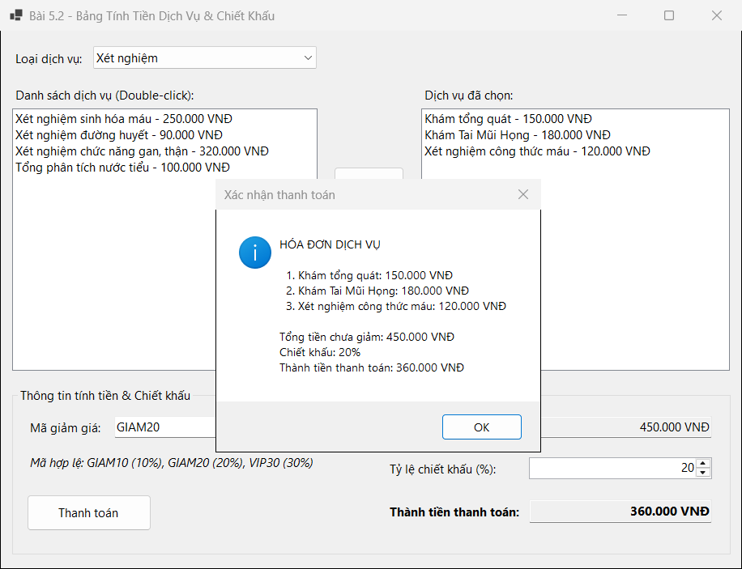

## THÔNG TIN SINH VIÊN
- **Họ và tên:** Phan Công Thành Đạt
- **Mã số sinh viên:** 24810310223
- **Lớp:** D19CNPM3
- **Tên môn học:** Lập trình .NET / Windows Forms
- **Tên bài tập:** Bài 5.2: Bảng tính tiền dịch vụ và chiết khấu đơn hàng (ListBox & ComboBox)

---

## DANH SÁCH ẢNH CHỤP MINH HỌA KẾT QUẢ

### 1. Giao diện khởi động & nạp dịch vụ theo loại trên ComboBox (`cboCategory`)

---

### 2. Chọn dịch vụ sang `lstSelectedServices`, áp dụng mã giảm giá (`GIAM20`) & tự động tính tiền

---

### 3. Xác nhận hóa đơn thanh toán dịch vụ

