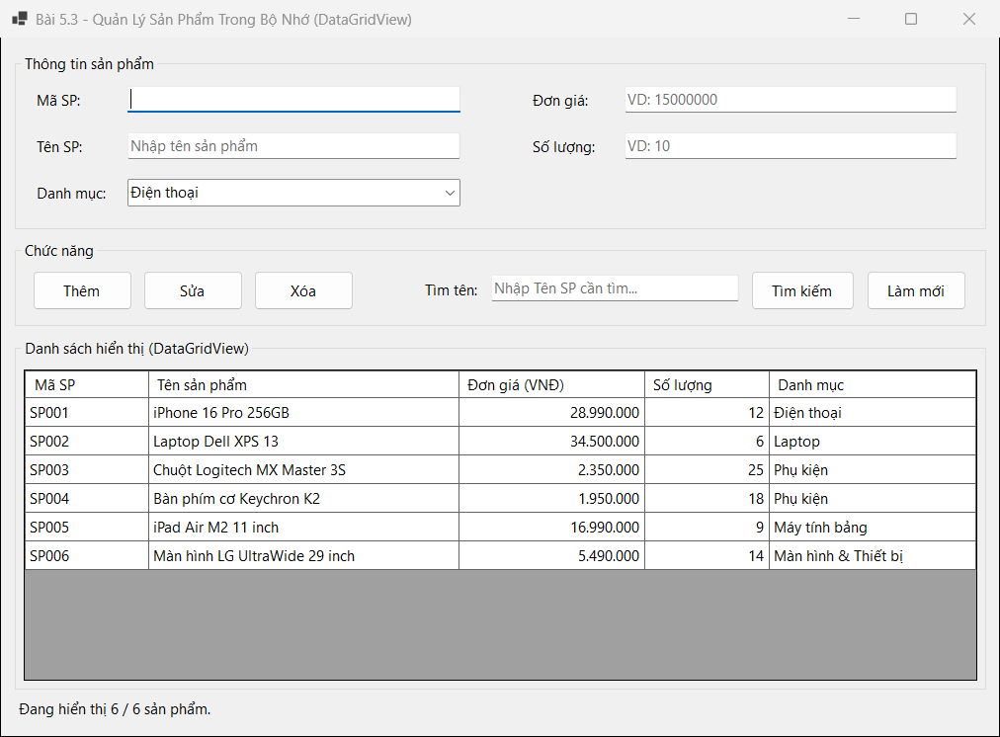
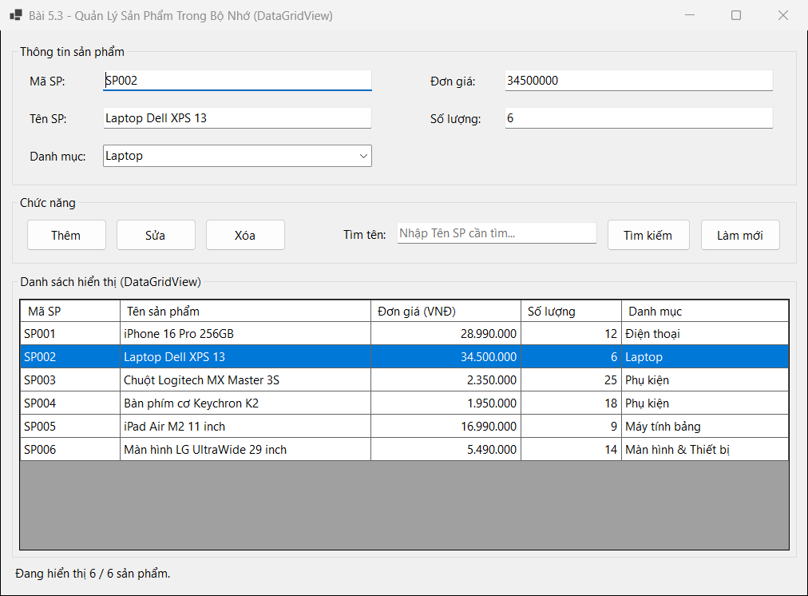
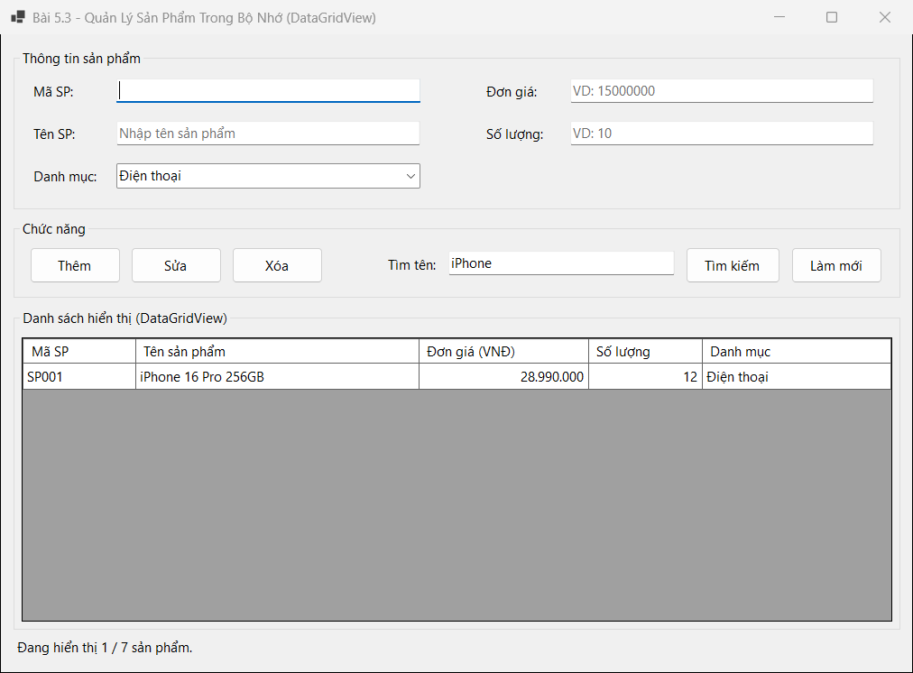

## THÔNG TIN SINH VIÊN
- **Họ và tên:** Phan Công Thành Đạt
- **Mã số sinh viên:** 24810310223
- **Lớp:** D19CNPM3
- **Tên môn học:** Lập trình .NET / Windows Forms
- **Tên bài tập:** Bài 5.3: Form quản lý danh sách sản phẩm trong bộ nhớ (DataGridView cơ bản)

---

## DANH SÁCH ẢNH CHỤP MINH HỌA KẾT QUẢ

### 1. Giao diện khởi động & hiển thị danh sách sản phẩm trên DataGridView (`BindingSource`)

---

### 2. Click dòng trên DataGridView đẩy ngược dữ liệu lên các ô nhập liệu

---

### 3. Thêm mới sản phẩm & tìm kiếm theo Tên SP (`iPhone`)

