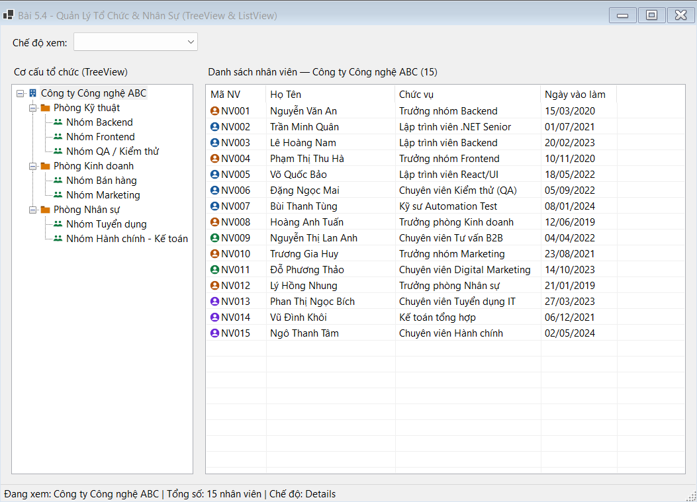
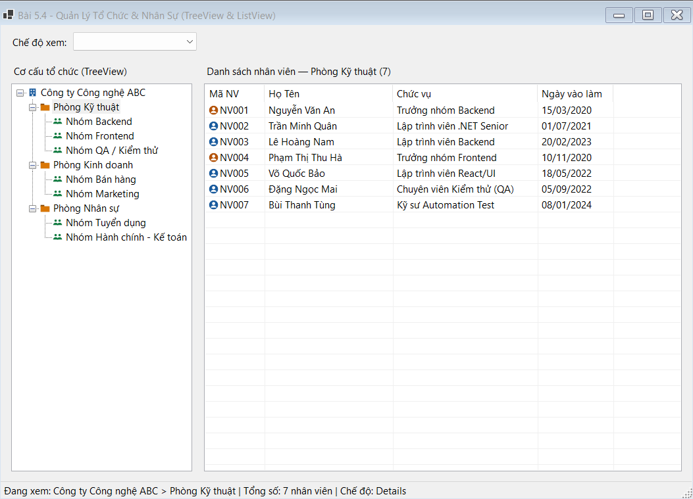
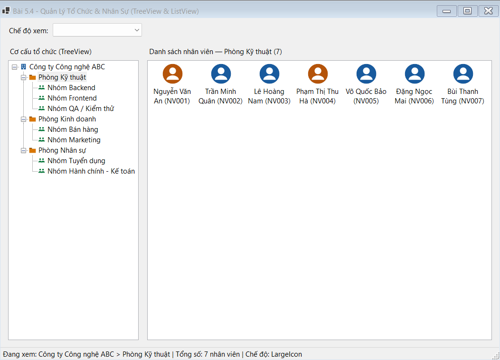
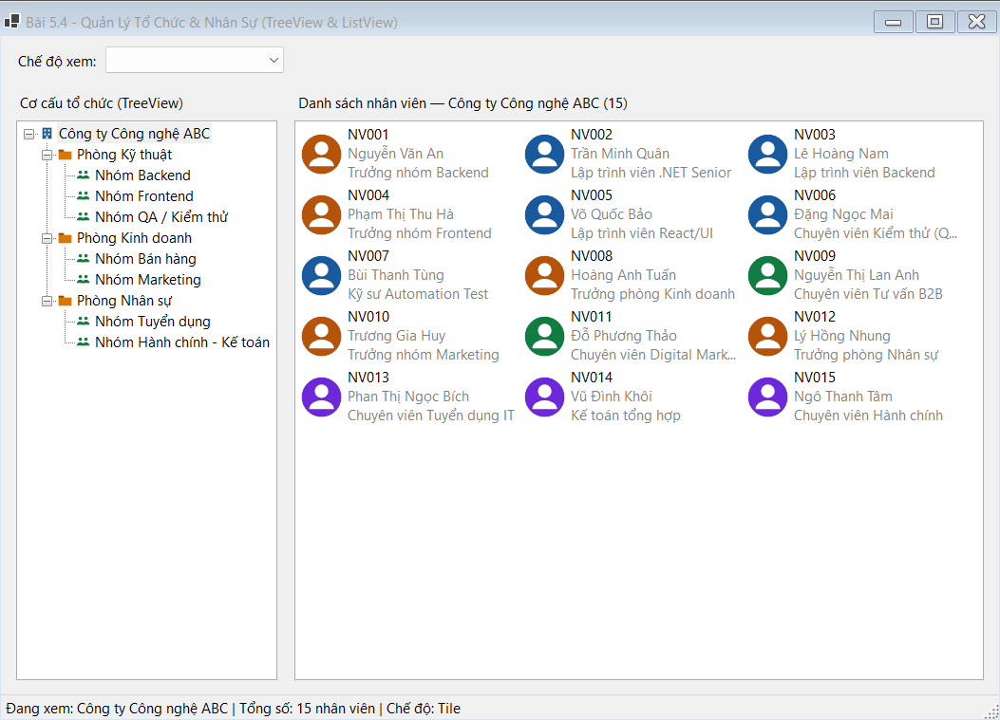

## THÔNG TIN SINH VIÊN
- **Họ và tên:** Phan Công Thành Đạt
- **Mã số sinh viên:** 24810310223
- **Lớp:** D19CNPM3
- **Tên môn học:** Lập trình .NET / Windows Forms
- **Tên bài tập:** Bài 5.4: Trình quản lý tổ chức & nhân sự chuyên nghiệp (TreeView & ListView)

---

## DANH SÁCH ẢNH CHỤP MINH HỌA KẾT QUẢ

### 1. Giao diện khởi động chế độ `Details` (4 cột: Mã NV, Họ Tên, Chức vụ, Ngày vào làm)

---

### 2. Click chọn Node phòng ban trên TreeView (`Phòng Kỹ thuật`) để lọc nhân viên vào ListView

---

### 3. Chế độ xem `LargeIcon`

---

### 4. Chế độ xem `Tile`

